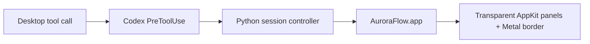

# Aurora Flow

A native macOS screen-edge glow for desktop automation and background tasks.

[中文说明](README.zh-CN.md) · [Download](https://github.com/renzhihe110/aurora-flow/releases/latest) · [MIT License](LICENSE)

Aurora Flow draws a calm cyan, blue and purple border around the real display. The center stays transparent, mouse input passes through, and task updates leave the current application focused. Top corners are rounded; bottom corners are square.

This repository includes both the **Swift/AppKit/Metal application** and a **Codex skill with lifecycle hooks** for `computer-use`, `cua_repl`, `agent-desktop` and `mac-input`.

## Downloads

| Release asset | Contents |
| --- | --- |
| `AuroraFlow-1.0.0-macOS-universal.zip` | Standalone menu bar App, Apple Silicon + Intel |
| `aurora-desktop-indicator-1.0.0.zip` | Complete Codex skill, installer, controller and bundled App |
| `SHA256SUMS.txt` | SHA-256 hashes of both ZIP files |

Requirements: macOS 13 or later and a Metal-capable Mac. The skill also requires Python 3.9+ and a local Codex installation with hooks support. The glow itself does not require Accessibility or Screen Recording permission; desktop automation tools retain their own permission requirements.

Prebuilt Apps are ad-hoc signed and **not notarized with Developer ID**. macOS may require you to review the application before allowing it to run. Building from source is also supported. The installer never removes quarantine attributes or bypasses Codex hook trust.

## Standalone App

Download and extract the App ZIP, move `AuroraFlow.app` to your preferred location, and open it. Click its menu bar sparkle to access Start, Success, Error, Stop and Cancel, plus live brightness, line width, speed, direction and display controls. Quit exits the App completely.

The App starts idle. Only opening the settings window intentionally gives that window keyboard focus; showing the border does not.

## Install the Codex skill

Download and extract **the complete skill ZIP** from [Releases](https://github.com/renzhihe110/aurora-flow/releases/latest), then run:

```bash
# Install the skill, merge lifecycle hooks and add a marked instruction block.
python3 aurora-desktop-indicator/scripts/install.py --enable-hooks
```

The default destination is `${CODEX_HOME:-~/.codex}/skills/aurora-desktop-indicator`. With `--enable-hooks`, the installer merges `hooks.json` and adds a marked block to `AGENTS.md` in the Codex configuration directory. Existing files are backed up before changes. It does not replace MCP configuration, `notify`, approval policy or saved trust records.

In Codex **Settings > Hooks** (or CLI `/hooks`), review and trust the five Aurora hooks, and check they are enabled. If the running client does not discover the changes, restart it or open a new chat. New definitions must go through normal trust review.

Without `--enable-hooks`, installation only adds the skill. You can explicitly invoke `$aurora-desktop-indicator` and let its instructions manage startup and cleanup.

Installer options:

```bash
# Install to a custom Codex configuration directory without changing environment variables.
python3 aurora-desktop-indicator/scripts/install.py --codex-home /path/to/codex --enable-hooks

# Upgrade an installation previously created by this installer.
python3 aurora-desktop-indicator/scripts/install.py --replace --enable-hooks

# Remove the managed skill, its exact hooks and its marked instruction block.
python3 aurora-desktop-indicator/scripts/install.py --uninstall
```

An existing unmanaged skill is left untouched. When using a custom Codex directory, pass the same `--codex-home` during upgrade and uninstall. The installer does not start the App or compile source.

## How automatic control works



- Desktop MCP tools and CUA calls are recognized by tool name. Direct `agent-desktop` shell commands are recognized at command positions.
- The first chat starts the bundled App; consecutive calls reuse it. Multiple chats share one managed process.
- CUA `completion_summary` releases that chat through `PostToolUse`. For other backends, the skill releases ownership when the desktop phase ends.
- `Stop`, `Interrupt` and `SessionEnd` provide normal lifecycle cleanup. Only the last owner exits the App.
- The controller checks executable identity and launch time before sending SIGTERM. Unrelated manually launched App instances are not terminated.
- Hooks do not approve, deny or rewrite the desktop tool call. Indicator failures report a warning and let the task continue.

Runtime state stays local under `~/Library/Application Support/CodexAurora/`. There is no network service, telemetry or always-running watcher. Abruptly killing Codex can prevent cleanup; recover with `stop --all`.

```bash
# Replace <skill-dir> with the installed skill directory; explicit sessions work outside Codex.
python3 '<skill-dir>/scripts/aurora.py' start --session preview
python3 '<skill-dir>/scripts/aurora.py' status
python3 '<skill-dir>/scripts/aurora.py' stop --session preview
```

## Build from source

Open `AuroraFlow.xcodeproj` in Xcode 16+, choose **AuroraFlow / My Mac**, and Run. The project is checked in; XcodeGen is optional. A local ad-hoc identity is configured, so a paid developer account is not required for local builds.

```bash
# Build only when you intentionally run this command.
xcodebuild -project AuroraFlow.xcodeproj -scheme AuroraFlow -configuration Release -destination 'generic/platform=macOS' -derivedDataPath build CODE_SIGN_IDENTITY=- build

# Install the source skill with the App you just built.
python3 skills/aurora-desktop-indicator/scripts/install.py --app build/Build/Products/Release/AuroraFlow.app --enable-hooks
```

If Xcode reports a missing Metal Toolchain, install it in Xcode Settings > Components or run `xcodebuild -downloadComponent MetalToolchain`.

Package an already built App without compiling:

```bash
# Create both distributable ZIPs and SHA256SUMS.txt under dist/.
python3 scripts/package_release.py --app build/Build/Products/Release/AuroraFlow.app
```

The packager strips embedded Metal source metadata when needed, rejects personal build paths in the binaries, and ad-hoc signs the release copy. App binaries and runtime state are excluded from Git; the complete binary-containing skill is distributed as a Release asset.

## Embed in a macOS project

Add `AuroraFlow/Core`, `Overlay` and `Rendering` to your target, including the `.metal` Compile Sources entry.

```swift
// Drive AppKit from the main actor; assigning configuration updates running overlays.
@MainActor
func beginTask() {
    AuroraBorder.config = AuroraConfig(borderWidth: 3, glowRadius: 24, animationDuration: 8, breathingDuration: 3, brightness: 0.85, clockwise: true, displayMode: .allScreens)
    AuroraBorder.start()
}
```

`AuroraBorder.success()`, `.error()`, `.cancel()` and `.stop()` provide completion feedback and fades. Dimensions are physical pixels. `cornerRadius` applies to the two top corners; display modes are all screens, primary screen, or a display UUID.

The standalone App also supports `auroraflow://start`, `success`, `error`, `stop`, `cancel`, `controls` and `configure`. For example, `open -g 'auroraflow://start'` requests a background transition. URL `stop` fades to idle; the skill controller's last release exits the process.

## Compatibility and validation

The renderer submits 24 vertices for four edge bands and updates a small time-driven uniform. The display center is transparent; there is no screen capture, desktop blur or full-screen blur pass. It requests the display's maximum refresh rate, and stops rendering when idle.

Standard full-screen Spaces use public AppKit window behavior. Lock/login screens, protected surfaces, exclusive display modes, Mission Control transitions and physical camera notches remain system-controlled. Multi-display and reconnection handling are implemented, but additional hardware validation is welcome.

See [architecture and lifecycle](docs/architecture.md) and [validation notes and manual checklist](docs/validation.md). Contributions and reproducible issue reports are welcome. This project is independent and is not affiliated with Apple or OpenAI.
